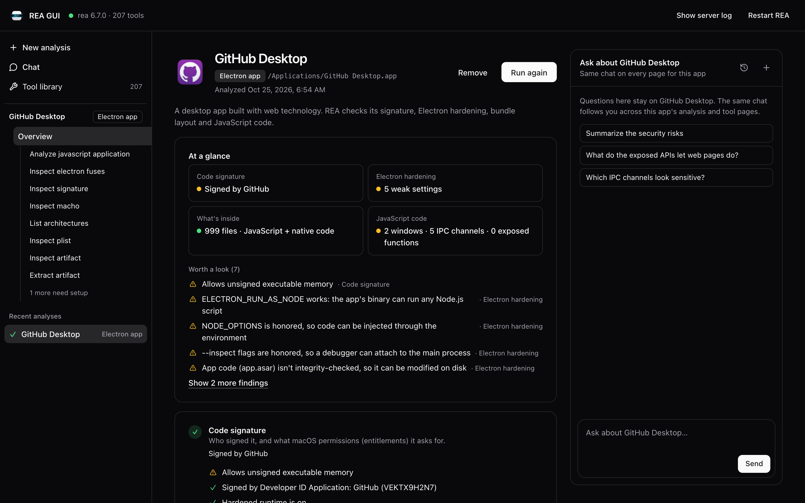
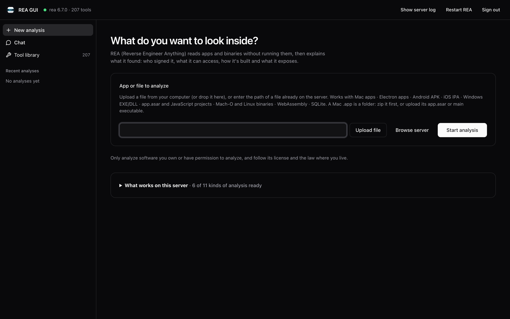
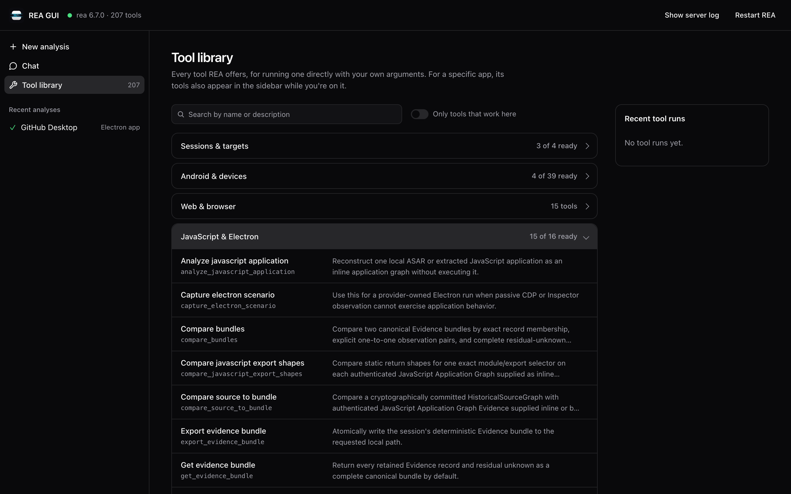

<p align="center"></p>

# REA GUI

[](https://github.com/dominusmaster/rea-gui/actions/workflows/ci.yml)

The open-source GUI for [REA: Reverse Engineer Anything](https://github.com/morluto/rea).
Self-host it: run it on your own computer in one command, or deploy it to your own
server with Docker. Nothing you analyze is executed.

```bash
git clone https://github.com/dominusmaster/rea-gui.git
cd rea-gui/rea-gui
npm install && npm start          # on your computer: http://localhost:4517/
# or, on a server:
echo "REA_GUI_PASSWORD=$(openssl rand -base64 24)" > .env && docker compose up -d
```

<picture>
  <source media="(prefers-color-scheme: light)" srcset="rea-gui/docs/screenshots/analysis-light.png">
  
</picture>

| Upload a file on your server | Every REA tool, searchable |
|---|---|
|  |  |

The app lives in [`rea-gui/`](rea-gui/); see its [README](rea-gui/README.md) for
features, deployment, settings and security.

> Unofficial, community-built; not affiliated with or endorsed by the REA project.

MIT licensed. Only analyze software you own or have permission to analyze.
